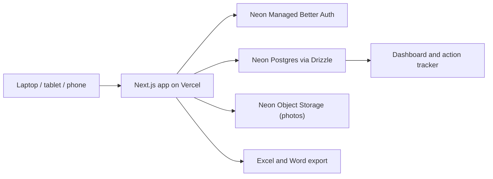
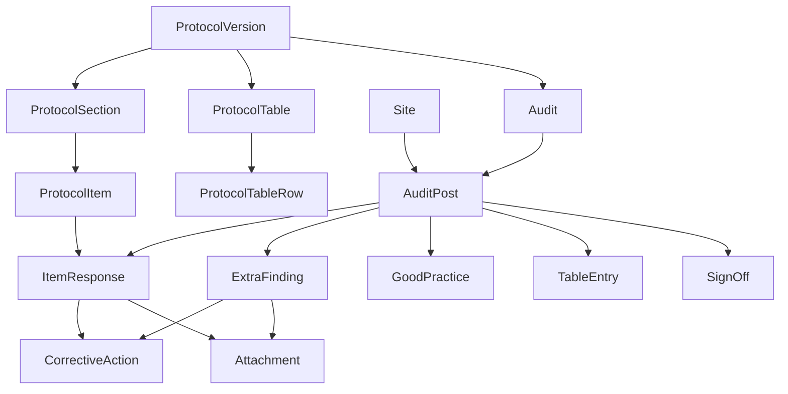

# FAP Audit App: Build Plan

A hosted web app that runs the First Aid Post and Ambulance audit protocol as section-by-section forms. It stores ticks, evidence, findings, photos and actions in a Neon Postgres database, shows a live dashboard and action tracker, and exports the Excel workbook and a draft Word report. It is built in five reviewable phases.

## Progress

- [x] Phase 1: Foundation (dependencies, git, env, Neon Auth, schema and migration, seed data, app shell with sign-in, read-only post checklist)
- [x] Phase 2: Audit forms (sections A to G with autosave, supplementary tables, H1 to H3, I1 to I4, photo upload)
- [x] Phase 3: Dashboard and action tracker
- [x] Phase 4: Exports and import (Excel export, Word report draft, Excel workbook import)
- [x] Phase 5: Deploy (Vercel project linked to GitHub, Neon `main` for production / `dev` for local+preview, trusted domain, env vars). Ongoing: phone/tablet smoke as needed.

**App version:** see `package.json` / `src/lib/version.ts` / `CHANGELOG.md` (currently **0.3.1**).

Deviations from the plan:

- Photos are stored in Postgres (`attachment.data`, a `bytea` column) because Neon Object Storage is not available in the project's region (eu-west-2). The storage code is isolated in `src/lib/storage.ts` so it can be moved later.
- UI primitives are hand-written in the shadcn style (`src/components/ui/index.tsx`) instead of being generated by the shadcn CLI.
- `cacheComponents` is turned off in `next.config.ts`: every page reads the session and the database, so nothing can be prerendered.

## Goals

- Replace the paper and Excel checklist with forms that follow the protocol section by section (A to I) and work on a laptop, tablet or phone.
- Capture everything an audit produces: Yes/No/N/A answers, evidence, photos, findings, classification, corrective actions, the supplementary tables (A2, B2, D2, E2, G2), H1 to H3, and the I3 conclusion and I4 sign-off.
- Show compliance and risk instantly on a dashboard, track actions through to close-out across audits, and export the Excel workbook and a draft Word report.
- Support recurring audits (quarterly or annual) on a versioned protocol.

## Current state

- Neon project **fap-audit** (`jolly-sun-18742594`, eu-west-2): branches **`main`** (production) and **`dev`** (local / Vercel preview). Drizzle migrations `0000`–`0002` applied on both.
- App repo: https://github.com/Nuestman/fap-audit-app — production https://fap-audit-app.vercel.app
- Sibling source still useful: `fap-audit-report` (`protocol.md`, workbooks, `build_workbook.py`).
- Directories in Settings: **Auditors** and **FAP staff** (table + modal CRUD); person pickers for lead/team/owners/nurse-in-charge; `app_config.fap_staff_model` global vs site-assigned.

## Technology

- **Framework:** Next.js 16 (App Router; Server Components and Server Actions), TypeScript and Tailwind v4, with shadcn/ui components.
- **Database:** Neon Postgres, accessed through Drizzle ORM and `@neondatabase/serverless`. Schema changes are managed as `drizzle-kit` migrations.
- **Login:** Neon Managed Better Auth (`@neondatabase/auth`), with route protection in `proxy.ts` (Next 16). Sign-up is restricted to an email allow-list (`ALLOWED_EMAILS`).
- **Validation:** Zod on every Server Action.
- **Photos:** Neon Object Storage, uploaded directly from the browser through presigned URLs.
- **Charts:** Recharts.
- **Exports and import:** `exceljs` for Excel export and workbook import; `docx` for the Word report.
- **Hosting:** Vercel, deployed after local testing.

## Architecture

## Data model

The protocol is stored as data, not hard-coded, so future versions don't break past audits.

### Protocol template

- **`protocol_version`:** name, version, effective date, active flag.
- **`protocol_section`:** code (A to G), title, sort order.
- **`protocol_item`:** code (e.g. `C1.12`), criterion text, sort order.
- **`protocol_table`** and **`protocol_table_row`:** the supplementary tables A2, B2, D2, E2 and G2. Each table stores its column definitions as JSON; each row stores its label.

### Audit data

- **`site`:** the posts ODD, STP, KMS and GCS, with name and location. More can be added later.
- **`auditor`:** directory of auditors (name, organisation, job title, optional email/phone/employee number, active). Names are snapshotted as text onto audits and actions.
- **`fap_staff`:** directory of FAP staff (same contact fields plus qualification, PIN status/expiry, optional `site_id` assignment, active).
- **`app_config`:** singleton settings (e.g. `fap_staff_model`: `global` or `site_assigned`).
- **`audit`:** title (e.g. "Q4 2026 FAP Audit"), period, protocol version, lead auditor, auditors, status (draft, in progress or final), and the report narrative fields (executive summary, scope notes, limitations, conclusion).
- **`audit_post`:** one per post in each audit. Holds audit date, shift, nurse-in-charge, ambulance units, and the I3 fields: overall status, key strengths, key risks and recommendation.
- **`item_response`:** one per post per criterion (unique together). Holds the answer (yes, no or na), evidence, finding, classification (major_nc, minor_nc, ofi, obs or c), original note, `updated_by` and `updated_at`.
- **`extra_finding`:** entries for H1 (no matching criterion) and H3 (other issues). Holds finding or issue, linked reference, evidence, consequence, interim control, classification and original note.
- **`good_practice`:** H2 entries.
- **`table_entry`:** one row per post per supplementary table row, with the values stored as JSON.
- **`corrective_action`:** linked to an `item_response` or `extra_finding`. Holds action text, owner, target date, priority, status (open, in progress or closed), close-out evidence and closed date. This table feeds I2 and the action tracker across audits.
- **`attachment`:** photo or document metadata (storage key, file name, size, caption), linked to a response or finding.
- **`sign_off`:** I4 entries (role, name, date).

### Derived values (calculated in code, not stored)

- **Risk:** Major NC is Critical; Minor NC is Medium; OFI and OBS are Low.
- **Compliance:** Yes / (Yes + No), per section and per post.
- **Completion:** the share of criteria answered.

## Screens (routes under `src/app`)

- **`/auth/sign-in`:** Neon Auth sign-in page.
- **`/`:** list of audits, plus "New audit" (choose the period, posts and protocol version).
- **`/audits/[auditId]`:** overview with a card per post showing completion %, compliance % and the count of Major NCs.
- **`/audits/[auditId]/posts/[postId]/[section]`:** the main data-entry screen.
  - Tabs for Details and sections A to I; the section and its progress stay visible as you scroll.
  - Each criterion is a card with large Yes / No / N/A buttons.
  - Answering No reveals evidence, finding, classification (with the definitions shown inline) and corrective action (owner and target date). Answering Yes keeps evidence available.
  - Photo upload uses the device camera on phones.
  - Autosaves about 0.8 seconds after you stop typing, with a "Saved" indicator.
  - Filters: All, Unanswered, Non-conformities.
  - Supplementary tables appear inside their sections:
    - A2 in A, B2 in B, D2 in D (response times with automatic totals), E2 in E and G2 in G.
  - Section H holds H1 to H3. Section I holds the computed I1 summary, the I2 priority list, the I3 conclusion and the I4 sign-off.
- **`/audits/[auditId]/dashboard`:**
  - A heatmap of compliance by post and section.
  - Findings by classification and by risk, for each post.
  - A list of Major NCs.
  - Cross-site themes: criteria answered No at two or more posts, flagged as possibly systemic.
- **`/actions`:** the action tracker across all audits. Filter by post, owner, status and overdue; close an action with close-out evidence; owner uses the person picker.
- **`/audits/[auditId]/report`:**
  - Edit the narrative fields.
  - Preview the auto-generated sections.
  - Buttons to export Excel and Word.
- **`/settings`:** first aid posts; FAP staff model; auditors and FAP staff (table list + add/edit modal); protocol versions (read-only); allow-list display; about/version.
- **`/changelog`:** rendered release notes from `CHANGELOG.md`.

## Folder structure

- `src/db/schema.ts`: Drizzle schema. `src/db/index.ts`: database client.
- `src/db/seed/`:
  - `protocol-v1.ts`, generated once from `protocol.md`
  - `sites.ts`
  - `kms-odd-drafts.ts`, ported from `build_workbook.py`
  - `seed.ts`
- `src/lib/auth/server.ts` and `src/lib/auth/client.ts`, plus `proxy.ts`.
- `src/lib/audit/`:
  - `classification.ts`, holding the classification and risk types with an exhaustive switch
  - `metrics.ts`, for compliance and completion calculations
  - `themes.ts`, for cross-site detection
- `src/app/(app)/...`: the protected pages listed above, with Server Actions in `actions.ts` next to each page.
- `src/components/audit/`: `CriterionCard`, `SectionTabs`, `AutosaveField`, `PhotoUpload`, `SupplementaryTable`, `ClassificationSelect`.
- `src/lib/export/excel.ts`, `src/lib/export/word-report.ts`, `src/lib/import/workbook.ts`.

## Phases (each ends with a review before the next starts)

### Phase 1: Foundation

- Initialise git (local commits only after approval; nothing is pushed).
- Install the extra dependencies (Drizzle, Neon serverless driver, Neon Auth, Zod, shadcn/ui).
- Create `.env.local` with:
  - `DATABASE_URL`
  - `NEON_AUTH_BASE_URL`
  - `NEON_AUTH_COOKIE_SECRET`
  - `ALLOWED_EMAILS`
- Enable Managed Better Auth on the `fap-audit` project.
- Write the Drizzle schema and the first migration.
- Seed:
  - protocol v1 (105 criteria plus the supplementary tables)
  - the 4 posts
  - a "Q4 2026 FAP Audit" covering all 4 posts
  - the KMS and ODD draft findings, H1 and H3 items, and original notes
- Build the app shell with sign-in, the audits list, the audit overview, and a read-only view of a post's checklist.
- **Done when:** you can sign in, open the Q4 2026 audit, and see the KMS and ODD drafts against the right criteria.

### Phase 2: Audit forms

- Build the section A to G forms with autosave, the conditional finding and action fields, and filters.
- Add the supplementary tables (A2, B2, D2 with time totals, E2, G2), H1 to H3, and the I section (I1 to I4).
- Add photo upload to Neon Object Storage.
- Add progress and completion indicators, and mobile layout checks.
- **Done when:** a full post audit can be entered on a phone and on a laptop, and the data survives a page reload.

### Phase 3: Dashboard and action tracker

- Build the compliance heatmap, the classification and risk charts, the Major NC list and the cross-site themes.
- Build the action tracker, with close-out evidence and overdue flags.
- **Done when:** the numbers match a hand count for KMS and ODD.

### Phase 4: Exports and import

- **Excel export:** the same layout as `FAP Audit Workbook.xlsx`, so it can be shared with people who don't use the app.
- **Word report draft**, following the agreed structure:
  1. Cover and document control
  2. Executive summary
  3. Introduction and methodology
  4. Overall results table
  5. Cross-site themes
  6. Per-site findings
  7. Good practices
  8. Consolidated action plan
  9. Conclusion and sign-off
  10. Appendices with each post's completed checklist
- **Excel import:** loads a filled-in copy of the workbook, so data typed into the spreadsheet in the meantime isn't lost.
- **Done when:** the exported report opens in Word with every section filled from the data.

### Phase 5: Deploy

- Create a Vercel project and set the environment variables.
- Use a Neon production branch, with development on a separate Neon branch.
- Add the Vercel domain to the Auth trusted domains.
- Smoke-test on a phone and tablet.
- **Done when:** you can sign in from your phone at the Vercel URL and complete a test audit.

## Security and data handling

- Every page and Server Action checks the session server-side. Sign-up is limited to the allow-list.
- No patient identifiers should go in findings or photos. The forms will carry a reminder, and photos are for equipment and premises only.
- Each response and action records who last changed it and when. Neon's point-in-time history (6 hours on the free tier) plus regular Excel exports act as backups.

## Later (not in this build)

- A protocol editor in the app, so the checklist can be changed without code.
- Roles for several auditors, and auditee access to update their own actions.
- Offline mode for sites with poor connectivity.
- Drawn signatures, and email reminders for overdue actions.

## Decisions taken as defaults (change any during review)

- Photos are stored in Neon Object Storage, not Vercel Blob, so everything stays in one Neon project.
- Corrective actions live in their own table, linked to findings, so the tracker can follow them across audits.
- Risk is always derived from classification and can't be edited separately. This keeps the two rating scales consistent.
- One response per criterion per post, matching the spreadsheet. Several findings for one criterion go in the same text field, using the most severe classification.
